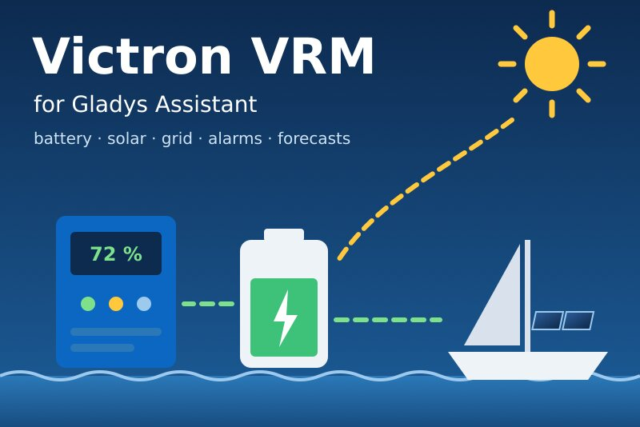
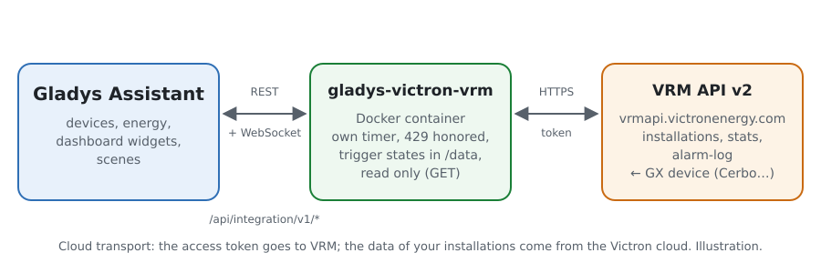
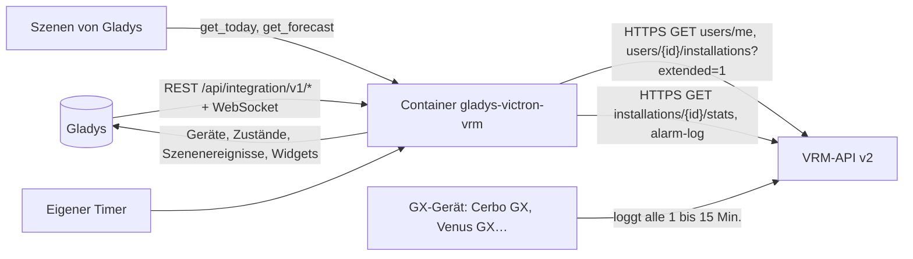
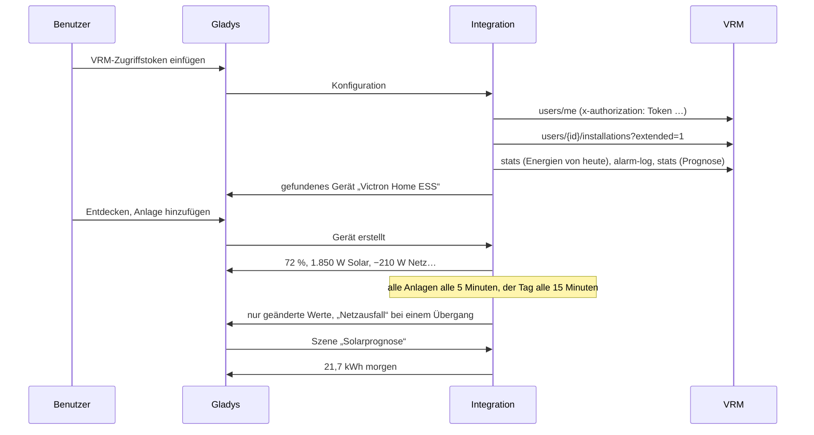
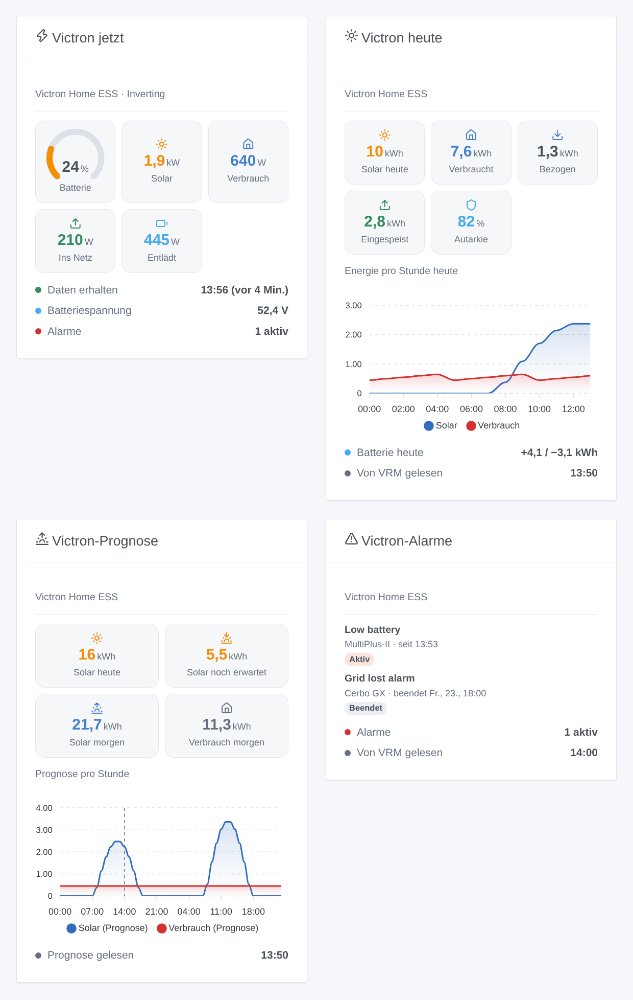

# Gladys Victron VRM

[English](README.md) · [Français](README.fr.md) · **Deutsch** · [Español](README.es.md)

[](LICENSE)
[](https://github.com/William-De71/gladys-victron-vrm/releases)
[](https://github.com/William-De71/gladys-victron-vrm/actions/workflows/release.yml)
[](https://gladysassistant.com)



Externe Integration für [Gladys Assistant](https://gladysassistant.com) für **Victron-Energy**-Anlagen (Haus-ESS, Inselanlagen, Campervans, Boote) über die offizielle [VRM-API](https://vrm-api-docs.victronenergy.com/) und ein persönliches Zugriffstoken. Sie zeigt in Gladys Batterie, Solar, Netz und AC-Verbrauch jeder Anlage, löst Szenen bei VRM-Alarmen, schwacher oder voller Batterie, Netzausfall oder einer stummen Anlage aus und bringt die VRM-Solarprognose in deine Szenen — nur lesend.

Benutzerdokumentation: [English](docs/en.md) · [Français](docs/fr.md) · [Deutsch](docs/de.md) · [Español](docs/es.md).

Nicht mit Victron Energy verbunden. **Noch nicht mit einem echten VRM-Konto getestet**: Anfragen und Felder folgen der offiziellen Dokumentation und wurden live am öffentlichen VRM-Demokonto geprüft; die Antwort auf ein falsches Token wurde echt geprüft.

## Funktionen

- Alle **Anlagen des VRM-Kontos** des Tokens, selbst gefunden, in **einer Anfrage** gelesen (standardmäßig alle 5 Minuten).
- **Ein Gerät pro Anlage**: Batteriestand, Lade- und Entladeleistung der Batterie, Batteriespannung, Solarleistung und Solarerzeugung des Tages, vorzeichenbehaftete Netzleistung, AC-Verbrauch und Verbrauch des Tages, Generatorleistung — nur was die Anlage hat.
- **9 Szenenauslöser** (VRM-Alarm ausgelöst, Alarm beendet, Batterie schwach, Batterie voll, Netzausfall, Netz zurück, Anlage offline, wieder online, Zugriff verweigert), **2 Szenenaktionen** (Energien von heute, Solar- und Verbrauchsprognose) und **4 Dashboard-Widgets** (Energiefluss jetzt, heute, Prognose, Alarme).
- **Nur lesend**: nur `GET`-Anfragen; keine Einstellung der Anlage wird je geändert.
- **Innerhalb der Grenzen von VRM**: eine Anfrage nach der anderen, nach einem 429 eine Pause so lange wie VRM verlangt (Retry-After), die Energien des Tages alle 15 Minuten, das Alarmprotokoll, wenn VRM eine Änderung zeigt, die Prognose stündlich.
- Überall vier Sprachen: Englisch, Französisch, Deutsch, Spanisch.

## Funktionsweise





Vom Token zur Szene:



### Transport

`transports: ["cloud"]`: Alles läuft über die Victron-Cloud (`vrmapi.victronenergy.com`), die die Daten vom GX-Gerät jeder Anlage erhält. **Das Zugriffstoken verlässt dein Netzwerk** (nur zu VRM); die Daten deiner Anlagen kommen von VRM. `/data` speichert die Liste der Anlagen, die letzten Abfragen, die Energien und die Prognose des Tages, das Alarmprotokoll, was die Auslöser wissen, und die VRM-Benutzer-ID — nie das Token.

## Geräte und Funktionen

| Gerät           | Funktionen (Kategorie / Typ)                                                                                                                                                                                                                                                                                                                                                                                                                                                                                                                                 |
| --------------- | ------------------------------------------------------------------------------------------------------------------------------------------------------------------------------------------------------------------------------------------------------------------------------------------------------------------------------------------------------------------------------------------------------------------------------------------------------------------------------------------------------------------------------------------------------------ |
| Eins pro Anlage | Batteriestand (`battery-storage` / `battery-level`, %), Lade- und Entladeleistung (`battery-storage` / `charge-power`, `discharge-power`, W), Batteriespannung (`energy-sensor` / `voltage`, V), Solarerzeugung (`energy-production-sensor` / `power`, W), Solarerzeugung heute (`energy-production-sensor` / `daily-production`, kWh), Netzleistung (`grid-sensor` / `power`, W, Bezug +), AC-Verbrauch (`energy-sensor` / `power`, W), Verbrauch heute (`energy-sensor` / `index-today`, kWh), Generatorleistung (`energy-production-sensor` / `power`, W) |

- VRM liefert die Batteriespannung und den vorzeichenbehafteten Batteriestrom (positiv beim Laden): Die Leistung ist ihr Produkt, aufgeteilt in Lade- und Entladeleistung, beide positiv, wie es die Kategorie Batteriespeicher von Gladys verlangt.
- Die Netzleistung behält ihr Vorzeichen (`from_to_grid` von VRM: Bezug > 0, Einspeisung < 0), mit symmetrischen Grenzen.
- Die Energien des Tages kommen aus den Energieflüssen, die VRM pro Stunde zählt (Solar zu Verbrauchern, Batterie und Netz; Batterie zu Verbrauchern und Netz; Netz zu Verbrauchern und Batterie; Generator), in der Zeitzone der Anlage.
- **Keine doppelte Zählung**: Keine dieser Funktionen ist ein `energy-sensor`-Zählerstand oder ein `daily-consumption`: Gladys zählt sie nie als Verbrauch oder Kosten des Hauses. Ein Linky (oder ein anderer Zähler) bleibt die Quelle des Energie-Dashboards.
- Die Funktionen Batterie, Solar, Netz und Generator gibt es nur, wenn die Anlage sie hat (ein einmal gesehener Wert oder was VRM sagt: `hasMains`, `hasGenerator`, `pvMax`); einmal da, bleiben sie. Die externen IDs beruhen auf der ID der Anlage in VRM (`ext:victron-vrm:site:<idSite>`).
- Werte, die älter als die Offline-Frist der Konfiguration sind, werden nicht erneut veröffentlicht: Gladys behält den letzten mit seiner Zeit.

## Szenenauslöser, Aktionen und Widgets



**Widgets**: Victron jetzt (Batterieanzeige, Solar, AC-Verbrauch, Netz hin oder her, Batterie lädt oder entlädt, Generator, Zustand des Systems, Batteriespannung, aktive Alarme, wann VRM zuletzt Daten erhielt), Victron heute (Solar, Verbrauch, Bezug, Einspeisung, Autarkie, Stundendiagramm, Batterie des Tages), Victron-Prognose (Solar heute, noch erwartet, morgen, Verbrauch morgen, Stundendiagramm für heute und morgen) und Victron-Alarme (das Alarmprotokoll von VRM, aktive zuerst).

**Auslöser** (ein Ereignis pro Übergang, nie bei der ersten Abfrage, nie als Folge einer Aktion):

- **Alarm ausgelöst** / **Alarm beendet**: Ein Eintrag des VRM-Alarmprotokolls wird aktiv oder endet (Batterie schwach, Netzausfall, Überlast, hohe Temperatur…); Variablen: Text, Victron-Gerät, Beginn und Ende, Dauer;
- **Batterie schwach** beim Stand der Konfiguration (erneut 5 Punkte höher); **Batterie voll** bei 100 % (erneut unter 95 %);
- **Netzausfall** / **Netz zurück**: der Netzalarm des Systems (`Agl`), mit seiner Dauer;
- **Anlage offline**: keine neuen Daten in VRM während der Frist der Konfiguration; **wieder online**, wenn Daten zurückkommen;
- **Zugriff verweigert**: VRM lehnt das Token ab — einmal pro Ablehnung.

Filter: die Anlage. Die Werte (Batteriestand, Leistungen) sind Gerätefunktionen: „Batterie über 80 %“ ist ein Geräteauslöser von Gladys.

**Aktionen**:

- **Energien von heute**: Solar, Verbrauch, Bezug, Einspeisung, Batterie geladen und entladen, Generator, Autarkie, Batteriestand und ein Satz, aus den letzten Abfragen (ohne Anfrage).
- **Solarprognose**: Solar heute, heute noch erwartet, morgen, Verbrauch heute und morgen (kWh) und ein Satz; von VRM gelesen, wenn die gespeicherte Prognose älter als eine Stunde ist.

Keine Aktion schreibt in die Anlage: Die VRM-API erlaubt das Schreiben einiger Einstellungen (Dynamic ESS, Alarmregeln), aber keine saubere Steuerung eines Wechselrichters oder Relais mit einem Fremd-Token; diese erste Version bleibt nur lesend.

Beispiele:

- Wenn **Victron VRM: Netzausfall** → eine Benachrichtigung „Stromausfall, Batterie bei {{triggerEvent.data.battery_level}} %“ senden und die Heizungen am Wechselrichter ausschalten.
- Jeden Abend um 21:00 → **Victron VRM: Solarprognose**; wenn **Solar morgen** unter 5 kWh liegt → den Warmwasserbereiter heute Nacht im Niedertarif einschalten.
- Wenn **Victron VRM: Anlage offline** → eine Benachrichtigung „Seit {{triggerEvent.data.minutes_without_data}} Min. keine Daten vom Boot“ senden.

## Voraussetzungen

- Gladys Assistant **5.1.0** oder neuer (Widgets und Szenen von Integrationen): Ältere Instanzen können die Integration nicht installieren.
- Eine Victron-Anlage mit einem GX-Gerät (Cerbo GX, Venus GX, Ekrano, ein Raspberry Pi mit Venus OS…), das seine Daten an [VRM](https://vrm.victronenergy.com) sendet, und ein **VRM-Zugriffstoken** (Preferences → Integrations → Access tokens).
- Internet: Die Integration spricht nur mit `vrmapi.victronenergy.com`.

### Das Tempo der API

VRM dokumentiert ein gleitendes Fenster von 200 Anfragen, von denen alle 0,33 s eine herausfällt (etwa 3 Anfragen pro Sekunde), und antwortet darüber mit 429 und einem Retry-After. Die Integration bleibt weit darunter: eine Anfrage nach der anderen, mindestens eine Sekunde Abstand; für eine Anlage etwa 19 Anfragen pro Stunde (alle Anlagen des Kontos alle 5 Minuten in einer Anfrage, die Energien des Tages alle 15 Minuten, das Alarmprotokoll alle 30 Minuten oder wenn VRM eine Änderung zeigt, die Prognose stündlich). Nach einem 429 wartet jede Anfrage das Retry-After ab (30 Sekunden bis eine Stunde).

## Installation

- **Aus dem Store**: Integrationen → Victron VRM → Installieren.
- **Über die URL des Repositorys**: Integrationen → externe Integration → `https://github.com/William-De71/gladys-victron-vrm`.
- **Entwicklermodus**: `npm start` mit den von Gladys gelieferten Variablen starten (siehe Entwicklung).

## Konfiguration

| Feld oder Schaltfläche                 | Standard    | Bedeutung                                                                             |
| -------------------------------------- | ----------- | ------------------------------------------------------------------------------------- |
| Zugriffstoken                          | —           | Pflicht, ein Geheimnis: nie wieder angezeigt, nie geloggt, nie in `/data` geschrieben |
| Abfrage der Anlagen                    | 5 Min.      | 1, 2, 5, 10 oder 15 Min.: eine Anfrage für alle Anlagen des Kontos                    |
| Stand des Auslösers „Batterie schwach“ | 20 %        | 10 bis 50 %                                                                           |
| Anlage offline nach                    | 1 Std.      | 30 Min., 1, 2 oder 4 Std. ohne neue Daten in VRM                                      |
| Sprache der Texte                      | automatisch | Namen der Funktionen, Szenentexte und Fehler                                          |
| Verbindung testen / Diagnose           | —           | Die Anlagen des Tokens und ihre letzten Daten; der Zustand in den Logs, ohne Token    |

## Nutzung

1. In [VRM](https://vrm.victronenergy.com/access-tokens): Preferences → Integrations → Access tokens, ein Token erstellen und kopieren.
2. In Gladys (Integrationen → Victron VRM → Konfiguration): das Token einfügen; **Verbindung testen** drücken.
3. **Entdecken**, dann deine Anlagen als Geräte hinzufügen.
4. Die Widgets zu einem Dashboard hinzufügen, Szenen mit den Funktionen, Auslösern und Aktionen bauen.

## Entwicklung

```bash
npm install
npm test                       # node --test, ein falsches VRM auf 127.0.0.1, nie das Netzwerk
npm run lint                   # ESLint
npm run format:check           # Prettier
npx github:GladysAssistant/integration-store . --skip-image-check
scripts/build-cover.sh         # cover.jpg aus docs/assets/cover.svg
docs/illustrations/render.sh   # docs/assets/widgets.<Sprache>.png
```

Lokal liest das SDK `GLADYS_HOST_API_URL`, `GLADYS_INTEGRATION_TOKEN` und `GLADYS_INTEGRATION_SELECTOR` (von Gladys im Entwicklermodus geliefert), die Integration liest `TZ`. `DEBUG=gladys-integration-sdk` zeigt die Logs des SDK.

Die Tests decken den HTTP-Client ab (Token-Header, 401 / 403 / 429 / 5xx, Retry-After, eine Anfrage nach der anderen), die Parser (Antworten der echten API am öffentlichen Demokonto aufgezeichnet, Nullwerte), die Prognose (lokale Tage, ein 25-Stunden-Tag), die Auslöser (Hysterese, Übergänge, Alarmprotokoll), die Geräte (die vom Entdecken-Bildschirm verlangten Felder, die Kategorieverträge des Kerns), die Widgets (`validateWidgetContent`), das Manifest, die vier Sprachen, das Release-Skript und die ganze Integration gegen das falsche Gladys des SDK und einen falschen VRM-HTTP-Server. `test/structure.test.js` friert alle bei Benutzern gespeicherten Schlüssel ein.

## Release-Prozess


Jeder Merge auf `main` startet die CI und berechnet dann die Version aus den [Conventional Commits](https://www.conventionalcommits.org/) seit dem letzten Tag: `feat` → Minor, `fix` / `perf` → Patch, `!` oder `BREAKING CHANGE` → Major (ein Minor unter 1.0.0); `docs`, `chore`, `ci`, `test`, `style`, `refactor`, `build` allein veröffentlichen nichts. Der Changelog-Abschnitt wird erzeugt, der Tag gepusht, das Multi-Architektur-Image gebaut, dann erhält `main` den Release-Commit, das GitHub Release wird erstellt und ein letzter Job prüft das öffentliche Image, den Store-Validator und das Topic.

- Der Titel des Pull Requests wird zum Squash-Commit, dann zur Changelog-Zeile: auf Englisch und für den Benutzer schreiben (`pr-title.yml` prüft es). `CHANGELOG.md` nie von Hand bearbeiten.
- 1.0.0 ist eine Entscheidung: Actions → Release → Run workflow mit `release-as: 1.0.0`. `dry-run` zeigt Version und Notizen, ohne zu veröffentlichen.
- **Geschützter Branch**: Das Release pusht seinen Commit mit `GITHUB_TOKEN` auf `main`. Das Ruleset `protect-main` (kein Löschen, kein Force-Push) lässt ihn durch; eine strengere Regel (Pull Request Pflicht, Status-Checks) bräuchte GitHub Actions in der Bypass-Liste oder eine GitHub App.
- Nach dem ersten Release das Paket auf `ghcr.io` öffentlich machen (Package settings → Change visibility), sonst kann Gladys es nicht laden.

## Fehlerbehebung

Siehe [docs/de.md](docs/de.md#fehlerbehebung). Melde Probleme mit den Versionen von Gladys und der Integration, dem GX-Gerät und seinem Log-Intervall, der Meldung von **Verbindung testen** und dem Ergebnis von **Diagnose** (in den Logs der Integration). Füge nie dein Zugriffstoken ein.

## Mitwirken

Issues und Pull Requests sind willkommen. Führe vor einem Pull Request `npm run format:check && npm run lint && npm test` aus und lass alle externen IDs und gespeicherten Schlüssel unverändert (siehe [CLAUDE.md](CLAUDE.md)).

## Sicherheit

Siehe [SECURITY.md](SECURITY.md): Schwachstellen bitte vertraulich melden. Das Zugriffstoken ist ein `secret`-Feld: nie geloggt, nie in `/data` geschrieben, nur an `vrmapi.victronenergy.com` gesendet. Ein VRM-Token öffnet das ganze Konto: Die Integration nutzt es nur zum Lesen.

## Kommende Screenshots

Die Bilder oben sind Illustrationen, keine Screenshots. Echte Screenshots kommen in `docs/assets/screenshots/` (PNG, 1280 × 800): `configuration.png`, `discovery.png`, `device.png` (eine Anlage mit ihren Funktionen), `scene-grid-lost.png` (eine Szene mit dem Auslöser „Netzausfall“), `dashboard.png` (die vier Widgets an einer echten Anlage).

## Lizenz

[Apache License 2.0](LICENSE) — siehe auch [NOTICE](NOTICE). Victron Energy und VRM sind Marken ihres Inhabers. Danke an die Dokumentation und das SDK von Gladys, an Victron Energy für die öffentliche Dokumentation der VRM-API und das Demokonto und an die Autoren der Home-Assistant-Integration „Victron Remote Monitoring“.
