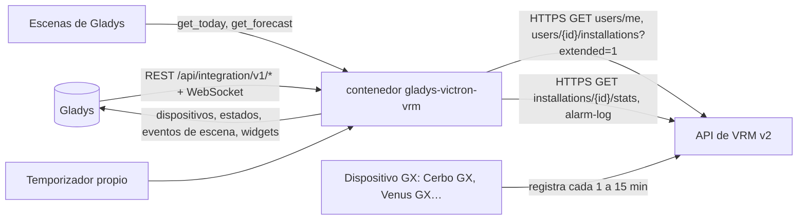
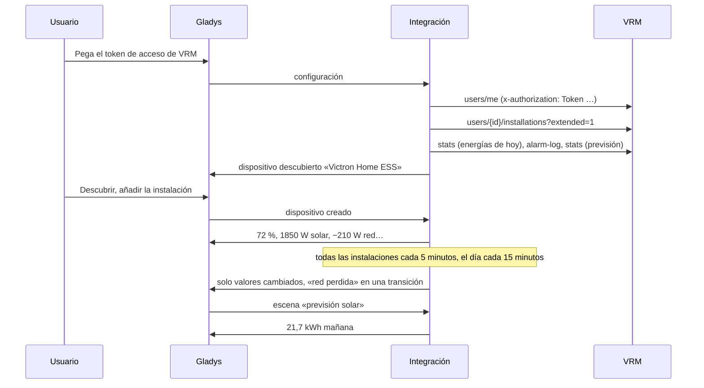
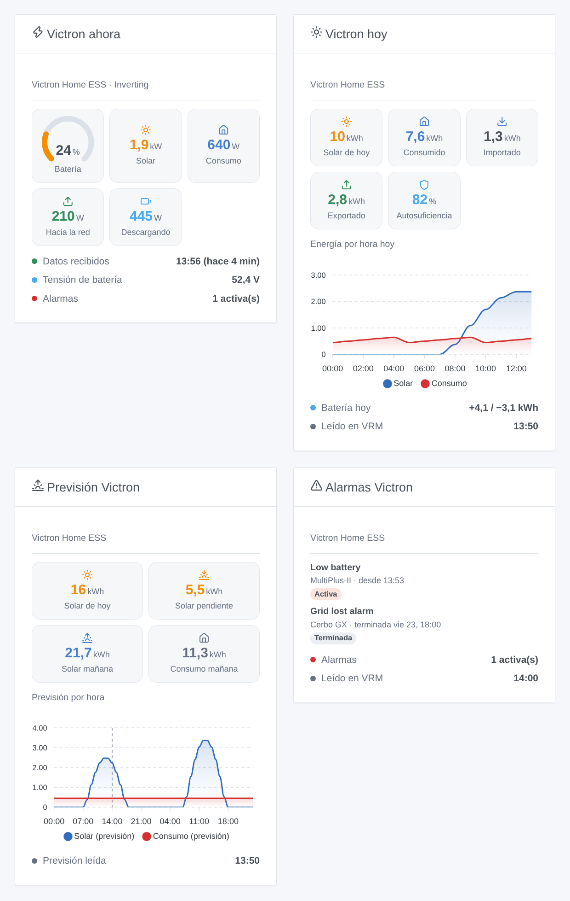

# Gladys Victron VRM

[English](README.md) · [Français](README.fr.md) · [Deutsch](README.de.md) · **Español**

[](LICENSE)
[](https://github.com/William-De71/gladys-victron-vrm/releases)
[](https://github.com/William-De71/gladys-victron-vrm/actions/workflows/release.yml)
[](https://gladysassistant.com)


Integración externa de [Gladys Assistant](https://gladysassistant.com) para las instalaciones **Victron Energy** (ESS doméstico, instalaciones aisladas, autocaravanas, barcos) mediante la [API de VRM](https://vrm-api-docs.victronenergy.com/) oficial y un token de acceso personal. Muestra en Gladys la batería, la producción solar, la red y el consumo AC de cada instalación, dispara escenas ante alarmas de VRM, una batería baja o llena, un corte de red o una instalación que deja de enviar datos, y pone la previsión solar de VRM al alcance de sus escenas — solo lectura.

Documentación de usuario: [English](docs/en.md) · [Français](docs/fr.md) · [Deutsch](docs/de.md) · [Español](docs/es.md).

No afiliada a Victron Energy. **Aún no probada con una cuenta VRM real**: las peticiones y los campos siguen la documentación oficial y se comprobaron en directo con la cuenta de demostración pública de VRM; la respuesta a un token incorrecto se comprobó de verdad.

## Funciones

- Todas las **instalaciones de la cuenta VRM** del token, encontradas solas, leídas en **una sola petición** (cada 5 minutos por defecto).
- **Un dispositivo por instalación**: nivel de batería, potencias de carga y descarga de la batería, tensión de la batería, potencia solar y producción solar del día, potencia de red con signo, consumo AC y consumo del día, potencia del generador — solo lo que tiene la instalación.
- **9 disparadores de escena** (alarma de VRM activada, alarma terminada, batería baja, batería llena, red perdida, red restablecida, instalación sin conexión, de nuevo en línea, acceso rechazado), **2 acciones de escena** (energías de hoy, previsión solar y de consumo) y **4 widgets** (flujo de energía ahora, hoy, previsión, alarmas).
- **Solo lectura**: únicamente peticiones `GET`; nunca se cambia un ajuste de la instalación.
- **Dentro de los límites de VRM**: una petición cada vez, una pausa del tiempo que pide VRM tras un 429 (Retry-After), las energías del día cada 15 minutos, el registro de alarmas cuando VRM muestra un cambio, la previsión cada hora.
- Cuatro idiomas en todas partes: inglés, francés, alemán, español.

## Funcionamiento




Del token a la escena:



### Transporte

`transports: ["cloud"]`: todo pasa por la nube de Victron (`vrmapi.victronenergy.com`), que recibe los datos del dispositivo GX de cada instalación. **El token de acceso sale de su red** (solo hacia VRM); los datos de sus instalaciones vienen de VRM. `/data` guarda la lista de las instalaciones, las últimas lecturas, las energías y la previsión del día, el registro de alarmas, lo que saben los disparadores y el id de usuario de VRM — nunca el token.

## Dispositivos y funciones

| Dispositivo         | Funciones (categoría / tipo)                                                                                                                                                                                                                                                                                                                                                                                                                                                                                                                                              |
| ------------------- | ------------------------------------------------------------------------------------------------------------------------------------------------------------------------------------------------------------------------------------------------------------------------------------------------------------------------------------------------------------------------------------------------------------------------------------------------------------------------------------------------------------------------------------------------------------------------- |
| Uno por instalación | Nivel de batería (`battery-storage` / `battery-level`, %), potencias de carga y descarga (`battery-storage` / `charge-power`, `discharge-power`, W), tensión de la batería (`energy-sensor` / `voltage`, V), producción solar (`energy-production-sensor` / `power`, W), producción solar de hoy (`energy-production-sensor` / `daily-production`, kWh), red eléctrica (`grid-sensor` / `power`, W, importación +), consumo AC (`energy-sensor` / `power`, W), consumo de hoy (`energy-sensor` / `index-today`, kWh), generador (`energy-production-sensor` / `power`, W) |

- VRM da la tensión de la batería y su corriente con signo (positiva al cargar): la potencia es su producto, separada en potencia de carga y de descarga, ambas positivas, como pide la categoría batería de almacenamiento de Gladys.
- La potencia de red conserva su signo (`from_to_grid` de VRM: importación > 0, exportación < 0), con límites simétricos.
- Las energías del día vienen de los flujos de energía que VRM cuenta por hora (solar hacia consumos, batería y red; batería hacia consumos y red; red hacia consumos y batería; generador), en la zona horaria de la instalación.
- **Sin doble cómputo**: ninguna de estas funciones es un índice `energy-sensor` ni un `daily-consumption`: Gladys nunca las cuenta como el consumo o el coste de la casa. Un Linky (u otro contador) sigue siendo la fuente del panel de energía.
- Las funciones de batería, solar, red y generador solo existen si la instalación las tiene (un valor visto una vez, o lo que dice VRM: `hasMains`, `hasGenerator`, `pvMax`); una vez presentes, se quedan. Los identificadores externos se basan en el id de la instalación en VRM (`ext:victron-vrm:site:<idSite>`).
- Los valores más antiguos que el plazo sin conexión de la configuración no se vuelven a publicar: Gladys conserva el último con su hora.

## Disparadores, acciones de escena y widgets



**Widgets**: Victron ahora (indicador de batería, solar, consumo AC, red hacia o desde, batería cargando o descargando, generador, estado del sistema, tensión de la batería, alarmas activas, cuándo recibió VRM los últimos datos), Victron hoy (solar, consumo, importación, exportación, autosuficiencia, gráfico por horas, batería del día), Previsión Victron (solar de hoy, pendiente, mañana, consumo de mañana, gráfico por horas para hoy y mañana) y Alarmas Victron (el registro de alarmas de VRM, activas primero).

**Disparadores** (un evento por transición, nunca en la primera lectura, nunca como resultado de una acción):

- **alarma activada** / **alarma terminada**: una entrada del registro de alarmas de VRM se activa o termina (batería baja, red perdida, sobrecarga, temperatura alta…); variables: el texto, el equipo Victron, las horas de inicio y fin, la duración;
- **batería baja** al nivel de la configuración (de nuevo 5 puntos más arriba); **batería llena** al 100 % (de nuevo por debajo del 95 %);
- **red perdida** / **red restablecida**: la alarma de red del sistema (`Agl`), con su duración;
- **instalación sin conexión**: sin datos nuevos en VRM durante el plazo de la configuración; **de nuevo en línea** cuando vuelven los datos;
- **acceso rechazado**: VRM rechaza el token — una vez por rechazo.

Filtro: la instalación. Los valores (nivel de batería, potencias) son funciones del dispositivo: «batería por encima del 80 %» es un disparador de dispositivo de Gladys.

**Acciones**:

- **energías de hoy**: solar, consumo, importación, exportación, batería cargada y descargada, generador, autosuficiencia, nivel de batería y una frase, según las últimas lecturas (sin petición).
- **previsión solar**: solar de hoy, pendiente hoy, mañana, consumo de hoy y de mañana (kWh) y una frase; leída en VRM cuando la previsión guardada tiene más de una hora.

Ninguna acción escribe en la instalación: la API de VRM permite escribir algunos ajustes (Dynamic ESS, reglas de alarma), no controlar limpiamente un inversor o un relé con un token de terceros; esta primera versión es de solo lectura.

Ejemplos:

- Cuando **Victron VRM: red perdida** → enviar una notificación «Corte de luz, batería al {{triggerEvent.data.battery_level}} %» y apagar los radiadores conectados al inversor.
- Cada noche a las 21:00 → **Victron VRM: previsión solar**; si **solar mañana** es inferior a 5 kWh → encender el termo en horas valle esta noche.
- Cuando **Victron VRM: instalación sin conexión** → enviar una notificación «Sin datos del barco desde hace {{triggerEvent.data.minutes_without_data}} min».

## Requisitos previos

- Gladys Assistant **5.3.0** o posterior (widgets y escenas de integraciones; palabras clave y países del catálogo de Gladys 5.3): las instancias más antiguas no pueden instalar la integración.
- Una instalación Victron con un dispositivo GX (Cerbo GX, Venus GX, Ekrano, una Raspberry Pi con Venus OS…) que envía sus datos a [VRM](https://vrm.victronenergy.com), y un **token de acceso de VRM** (Preferences → Integrations → Access tokens).
- Internet: la integración solo habla con `vrmapi.victronenergy.com`.

### El ritmo de la API

VRM documenta una ventana deslizante de 200 peticiones, de la que sale una cada 0,33 s (unas 3 peticiones por segundo), y responde 429 con un Retry-After por encima. La integración queda muy por debajo: una petición cada vez, al menos un segundo de separación; para una instalación, unas 19 peticiones por hora (todas las instalaciones de la cuenta cada 5 minutos en una petición, las energías del día cada 15 minutos, el registro de alarmas cada 30 minutos o cuando VRM muestra un cambio, la previsión cada hora). Tras un 429, cada petición espera el Retry-After (de 30 segundos a una hora).

## Instalación

- **Desde la tienda**: Integraciones → Victron VRM → Instalar.
- **Desde la URL del repositorio**: Integraciones → integración externa → `https://github.com/William-De71/gladys-victron-vrm`.
- **Modo desarrollador**: ejecute `npm start` con las variables que da Gladys (ver Desarrollo).

## Configuración

| Campo o botón                       | Por defecto | Significado                                                                                  |
| ----------------------------------- | ----------- | -------------------------------------------------------------------------------------------- |
| Token de acceso                     | —           | Obligatorio, un secreto: nunca se vuelve a mostrar, ni se registra, ni se escribe en `/data` |
| Lectura de las instalaciones        | 5 min       | 1, 2, 5, 10 o 15 min: una petición para todas las instalaciones de la cuenta                 |
| Nivel del disparador «batería baja» | 20 %        | De 10 a 50 %                                                                                 |
| Instalación sin conexión tras       | 1 h         | 30 min, 1 h, 2 h o 4 h sin datos nuevos en VRM                                               |
| Idioma de los textos                | automático  | Nombres de las funciones, textos de escenas y errores                                        |
| Probar la conexión / Diagnóstico    | —           | Las instalaciones del token y sus últimos datos; el estado en los registros, sin token       |

## Uso

1. En [VRM](https://vrm.victronenergy.com/access-tokens): Preferences → Integrations → Access tokens, cree un token y cópielo.
2. En Gladys (Integraciones → Victron VRM → Configuración): pegue el token; pulse **Probar la conexión**.
3. **Descubrir**, luego añada sus instalaciones como dispositivos.
4. Añada los widgets a un panel, cree escenas con las funciones, los disparadores y las acciones.

## Desarrollo

```bash
npm install
npm test                       # node --test, un VRM falso en 127.0.0.1, nunca la red
npm run lint                   # ESLint
npm run format:check           # Prettier
npx github:GladysAssistant/integration-store . --skip-image-check
scripts/build-cover.sh         # cover.jpg desde docs/assets/cover.svg
docs/illustrations/render.sh   # docs/assets/widgets.<idioma>.png
```

En local, el SDK lee `GLADYS_HOST_API_URL`, `GLADYS_INTEGRATION_TOKEN` y `GLADYS_INTEGRATION_SELECTOR` (que da Gladys en modo desarrollador), y la integración lee `TZ`. `DEBUG=gladys-integration-sdk` muestra los registros del SDK.

Las pruebas cubren el cliente HTTP (la cabecera del token, 401 / 403 / 429 / 5xx, Retry-After, una petición cada vez), los analizadores (respuestas grabadas de la API real con la cuenta de demostración pública, valores nulos), la previsión (días locales, un día de 25 horas), los disparadores (histéresis, transiciones, registro de alarmas), los dispositivos (los campos que exige la pantalla Descubrir, los contratos de categorías del núcleo), los widgets (`validateWidgetContent`), el manifiesto, los cuatro idiomas, el script de release y la integración completa frente al Gladys falso del SDK y un servidor VRM falso. `test/structure.test.js` congela todas las claves que guardan los usuarios.

## Proceso de release


Cada fusión en `main` lanza la CI y luego calcula la versión a partir de los [Conventional Commits](https://www.conventionalcommits.org/) desde la última etiqueta: `feat` → menor, `fix` / `perf` → parche, `!` o `BREAKING CHANGE` → mayor (una menor por debajo de 1.0.0); `docs`, `chore`, `ci`, `test`, `style`, `refactor`, `build` solos no publican nada. Se genera la sección del changelog, se sube la etiqueta, se construye la imagen multiarquitectura, luego `main` recibe el commit de release, se crea la GitHub Release y un último job comprueba la imagen pública, el validador de la tienda y el topic.

- El título de la pull request se convierte en el commit squash y luego en la línea del changelog: escríbalo en inglés, para el usuario (`pr-title.yml` lo comprueba). Nunca edite `CHANGELOG.md` a mano.
- La 1.0.0 es una decisión: Actions → Release → Run workflow con `release-as: 1.0.0`. `dry-run` muestra la versión y las notas sin publicar nada.
- **Rama protegida**: la release sube su commit a `main` con `GITHUB_TOKEN`. El ruleset `protect-main` (sin borrado, sin force-push) lo deja pasar; una regla más estricta (pull request obligatoria, status checks) necesitaría GitHub Actions en la lista de excepciones, o una GitHub App.
- Tras la primera release, haga público el paquete de `ghcr.io` (Package settings → Change visibility), o Gladys no podrá descargarlo.

## Solución de problemas

Ver [docs/es.md](docs/es.md#solución-de-problemas). Informe de los problemas con las versiones de Gladys y de la integración, el dispositivo GX y su intervalo de registro, el mensaje de **Probar la conexión** y el resultado de **Diagnóstico** (en los registros de la integración). Nunca pegue su token de acceso.

## Contribuir

Las incidencias y pull requests son bienvenidas. Ejecute `npm run format:check && npm run lint && npm test` antes de abrir una pull request y mantenga sin cambios todos los identificadores externos y claves guardadas (ver [CLAUDE.md](CLAUDE.md)).

## Seguridad

Ver [SECURITY.md](SECURITY.md): informe de las vulnerabilidades en privado. El token de acceso es un campo `secret`: nunca se registra, nunca se escribe en `/data`, solo se envía a `vrmapi.victronenergy.com`. Un token de VRM abre toda la cuenta: la integración solo lo usa para leer.

## Capturas pendientes

Las imágenes de arriba son ilustraciones, no capturas de pantalla. Las capturas reales irán en `docs/assets/screenshots/` (PNG, 1280 × 800): `configuration.png`, `discovery.png`, `device.png` (una instalación con sus funciones), `scene-grid-lost.png` (una escena con el disparador «red perdida»), `dashboard.png` (los cuatro widgets en una instalación real).

## Licencia

[Licencia Apache 2.0](LICENSE) — ver también [NOTICE](NOTICE). Victron Energy y VRM son marcas de su propietario. Gracias a la documentación y al SDK de Gladys, a Victron Energy por la documentación pública de la API de VRM y la cuenta de demostración, y a los autores de la integración de Home Assistant «Victron Remote Monitoring».
