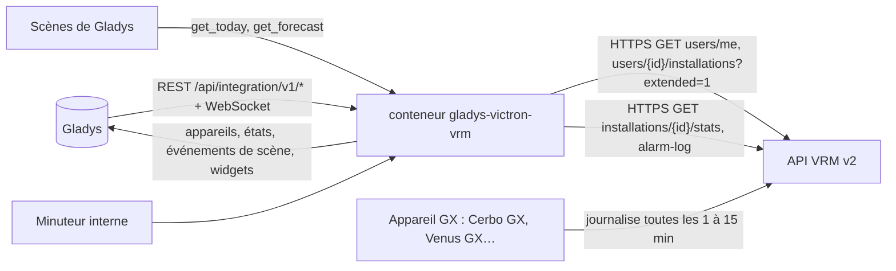
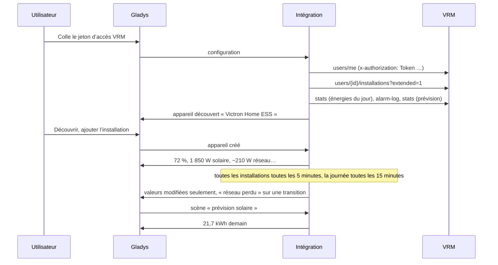
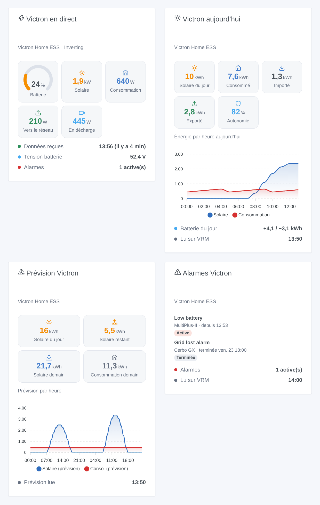

# Gladys Victron VRM

[English](README.md) · **Français** · [Deutsch](README.de.md) · [Español](README.es.md)

[](LICENSE)
[](https://github.com/William-De71/gladys-victron-vrm/releases)
[](https://github.com/William-De71/gladys-victron-vrm/actions/workflows/release.yml)
[](https://gladysassistant.com)


Intégration externe de [Gladys Assistant](https://gladysassistant.com) pour les installations **Victron Energy** (ESS de maison, sites isolés, vans, bateaux) via l’[API VRM](https://vrm-api-docs.victronenergy.com/) officielle et un jeton d’accès personnel. Elle affiche dans Gladys la batterie, le solaire, le réseau et la consommation AC de chaque installation, déclenche des scènes sur les alarmes VRM, une batterie faible ou pleine, une perte du réseau ou une installation muette, et met la prévision solaire VRM à disposition de vos scènes — en lecture seule.

Documentation utilisateur : [English](docs/en.md) · [Français](docs/fr.md) · [Deutsch](docs/de.md) · [Español](docs/es.md).

Non affiliée à Victron Energy. **Pas encore testée avec un vrai compte VRM** : les requêtes et les champs suivent la documentation officielle et ont été vérifiés en direct sur le compte de démonstration public de VRM ; la réponse à un mauvais jeton a été vérifiée pour de vrai.

## Fonctionnalités

- Toutes les **installations du compte VRM** du jeton, trouvées toutes seules, lues en **une seule requête** (toutes les 5 minutes par défaut).
- **Un appareil par installation** : niveau de batterie, puissances de charge et de décharge de la batterie, tension de la batterie, puissance solaire et production solaire du jour, puissance réseau signée, consommation AC et consommation du jour, puissance du groupe électrogène — seulement ce que l’installation possède.
- **9 déclencheurs de scène** (alarme VRM levée, alarme terminée, batterie faible, batterie pleine, réseau perdu, réseau rétabli, installation hors ligne, de retour, accès refusé), **2 actions de scène** (énergies du jour, prévision solaire et de consommation) et **4 widgets** (flux d’énergie en direct, aujourd’hui, prévision, alarmes).
- **Lecture seule** : uniquement des requêtes `GET` ; aucun réglage de l’installation n’est jamais modifié.
- **Dans les limites de VRM** : une requête à la fois, une pause du délai demandé par VRM après un 429 (Retry-After), les énergies du jour toutes les 15 minutes, le journal des alarmes quand VRM signale un changement, la prévision toutes les heures.
- Quatre langues partout : anglais, français, allemand, espagnol.

## Fonctionnement




Du jeton à la scène :



### Transport

`transports: ["cloud"]` : tout passe par le cloud de Victron (`vrmapi.victronenergy.com`), qui reçoit les données de l’appareil GX de chaque installation. **Le jeton d’accès quitte votre réseau** (vers VRM uniquement) ; les données de vos installations viennent de VRM. `/data` garde la liste des installations, les dernières lectures, les énergies et la prévision du jour, le journal des alarmes, ce que savent les déclencheurs et l’identifiant d’utilisateur VRM — jamais le jeton.

## Appareils et fonctionnalités

| Appareil            | Fonctionnalités (catégorie / type)                                                                                                                                                                                                                                                                                                                                                                                                                                                                                                                                                                         |
| ------------------- | ---------------------------------------------------------------------------------------------------------------------------------------------------------------------------------------------------------------------------------------------------------------------------------------------------------------------------------------------------------------------------------------------------------------------------------------------------------------------------------------------------------------------------------------------------------------------------------------------------------- |
| Un par installation | Niveau de batterie (`battery-storage` / `battery-level`, %), puissances de charge et de décharge (`battery-storage` / `charge-power`, `discharge-power`, W), tension de la batterie (`energy-sensor` / `voltage`, V), production solaire (`energy-production-sensor` / `power`, W), production solaire du jour (`energy-production-sensor` / `daily-production`, kWh), réseau électrique (`grid-sensor` / `power`, W, import +), consommation AC (`energy-sensor` / `power`, W), consommation du jour (`energy-sensor` / `index-today`, kWh), groupe électrogène (`energy-production-sensor` / `power`, W) |

- VRM donne la tension de la batterie et son courant signé (positif en charge) : la puissance est leur produit, séparée en puissance de charge et puissance de décharge, toutes deux positives, comme le veut la catégorie batterie de stockage de Gladys.
- La puissance réseau garde son signe (`from_to_grid` de VRM : import > 0, export < 0), avec des bornes symétriques.
- Les énergies du jour viennent des flux d’énergie que VRM compte par heure (solaire vers consommateurs, batterie et réseau ; batterie vers consommateurs et réseau ; réseau vers consommateurs et batterie ; groupe électrogène), dans le fuseau horaire de l’installation.
- **Pas de double comptage** : aucune de ces fonctionnalités n’est un index `energy-sensor` ni une `daily-consumption` : Gladys ne les compte jamais comme la consommation ou le coût de la maison. Un Linky (ou un autre compteur) reste la source du tableau de bord énergie.
- Les fonctionnalités batterie, solaire, réseau et groupe électrogène n’existent que si l’installation les a (une valeur vue une fois, ou ce que dit VRM : `hasMains`, `hasGenerator`, `pvMax`) ; une fois là, elles restent. Les identifiants externes reposent sur l’identifiant de l’installation dans VRM (`ext:victron-vrm:site:<idSite>`).
- Les valeurs plus anciennes que le délai hors ligne de la configuration ne sont pas republiées : Gladys garde la dernière avec son heure.

## Déclencheurs, actions de scène et widgets



**Widgets** : Victron en direct (jauge de batterie, solaire, consommation AC, réseau vers ou depuis, batterie en charge ou en décharge, groupe électrogène, état du système, tension de la batterie, alarmes actives, heure des dernières données reçues par VRM), Victron aujourd’hui (solaire, consommation, import, export, autonomie, graphique par heure, batterie du jour), Prévision Victron (solaire du jour, restant, demain, consommation demain, graphique par heure pour aujourd’hui et demain) et Alarmes Victron (le journal des alarmes de VRM, les actives d’abord).

**Déclencheurs** (un événement par transition, jamais à la première lecture, jamais en conséquence d’une action) :

- **alarme levée** / **alarme terminée** : une entrée du journal des alarmes VRM devient active ou se termine (batterie faible, réseau perdu, surcharge, température élevée…) ; variables : le texte, l’appareil Victron, les heures de début et de fin, la durée ;
- **batterie faible** au niveau de la configuration (à nouveau 5 points plus haut) ; **batterie pleine** à 100 % (à nouveau sous 95 %) ;
- **réseau perdu** / **réseau rétabli** : l’alarme réseau du système (`Agl`), avec sa durée ;
- **installation hors ligne** : pas de nouvelles données dans VRM pendant le délai de la configuration ; **de retour** quand les données reviennent ;
- **accès refusé** : VRM refuse le jeton — une fois par refus.

Filtre : l’installation. Les valeurs (niveau de batterie, puissances) sont des fonctionnalités d’appareil : « batterie au-dessus de 80 % » est un déclencheur d’appareil de Gladys.

**Actions** :

- **énergies du jour** : solaire, consommation, import, export, batterie chargée et déchargée, groupe électrogène, autonomie, niveau de batterie et une phrase, d’après les dernières lectures (sans requête).
- **prévision solaire** : solaire du jour, restant aujourd’hui, demain, consommation du jour et de demain (kWh) et une phrase ; lue sur VRM quand la prévision gardée a plus d’une heure.

Aucune action n’écrit sur l’installation : l’API VRM permet d’écrire certains réglages (Dynamic ESS, règles d’alarme), pas de piloter proprement un onduleur ou un relais depuis un jeton tiers ; cette première version reste en lecture seule.

Exemples :

- Quand **Victron VRM : réseau perdu** → envoyer une notification « Coupure de courant, batterie à {{triggerEvent.data.battery_level}} % » et éteindre les radiateurs branchés sur l’onduleur.
- Chaque soir à 21:00 → **Victron VRM : prévision solaire** ; si **solaire demain** est sous 5 kWh → allumer le chauffe-eau en heures creuses cette nuit.
- Quand **Victron VRM : installation hors ligne** → envoyer une notification « Plus de données du bateau depuis {{triggerEvent.data.minutes_without_data}} min ».

## Prérequis

- Gladys Assistant **5.3.0** ou plus récent (widgets et scènes des intégrations ; mots-clés et pays du catalogue de Gladys 5.3) : les instances plus anciennes ne peuvent pas installer l’intégration.
- Une installation Victron avec un appareil GX (Cerbo GX, Venus GX, Ekrano, un Raspberry Pi sous Venus OS…) qui envoie ses données à [VRM](https://vrm.victronenergy.com), et un **jeton d’accès VRM** (Preferences → Integrations → Access tokens).
- Internet : l’intégration ne parle qu’à `vrmapi.victronenergy.com`.

### Le rythme de l’API

VRM documente une fenêtre glissante de 200 requêtes, dont une sort toutes les 0,33 s (environ 3 requêtes par seconde), et répond 429 avec un Retry-After au-delà. L’intégration reste loin en dessous : une requête à la fois, une seconde d’écart au moins ; pour une installation, environ 19 requêtes par heure (toutes les installations du compte toutes les 5 minutes en une requête, les énergies du jour toutes les 15 minutes, le journal des alarmes toutes les 30 minutes ou quand VRM signale un changement, la prévision toutes les heures). Après un 429, chaque requête attend le Retry-After (de 30 secondes à une heure).

## Installation

- **Depuis le store** : Intégrations → Victron VRM → Installer.
- **Depuis l’URL du dépôt** : Intégrations → intégration externe → `https://github.com/William-De71/gladys-victron-vrm`.
- **Mode développeur** : lancez `npm start` avec les variables données par Gladys (voir Développement).

## Configuration

| Champ ou bouton                           | Défaut      | Rôle                                                                                    |
| ----------------------------------------- | ----------- | --------------------------------------------------------------------------------------- |
| Jeton d’accès                             | —           | Obligatoire, un secret : jamais réaffiché, jamais journalisé, jamais écrit dans `/data` |
| Lecture des installations                 | 5 min       | 1, 2, 5, 10 ou 15 min : une requête pour toutes les installations du compte             |
| Niveau du déclencheur « batterie faible » | 20 %        | De 10 à 50 %                                                                            |
| Installation hors ligne après             | 1 h         | 30 min, 1 h, 2 h ou 4 h sans nouvelles données dans VRM                                 |
| Langue des textes                         | automatique | Noms des fonctionnalités, textes des scènes et erreurs                                  |
| Tester la connexion / Diagnostic          | —           | Les installations du jeton et leurs dernières données ; l’état dans les journaux        |

## Utilisation

1. Dans [VRM](https://vrm.victronenergy.com/access-tokens) : Preferences → Integrations → Access tokens, créez un jeton et copiez-le.
2. Dans Gladys (Intégrations → Victron VRM → Configuration) : collez le jeton ; appuyez sur **Tester la connexion**.
3. **Découvrir**, puis ajoutez vos installations comme appareils.
4. Ajoutez les widgets à un tableau de bord, construisez des scènes avec les fonctionnalités, les déclencheurs et les actions.

## Développement

```bash
npm install
npm test                       # node --test, un faux VRM sur 127.0.0.1, jamais le réseau
npm run lint                   # ESLint
npm run format:check           # Prettier
npx github:GladysAssistant/integration-store . --skip-image-check
scripts/build-cover.sh         # cover.jpg depuis docs/assets/cover.svg
docs/illustrations/render.sh   # docs/assets/widgets.<langue>.png
```

En local, le SDK lit `GLADYS_HOST_API_URL`, `GLADYS_INTEGRATION_TOKEN` et `GLADYS_INTEGRATION_SELECTOR` (donnés par Gladys en mode développeur), et l’intégration lit `TZ`. `DEBUG=gladys-integration-sdk` affiche les journaux du SDK.

Les tests couvrent le client HTTP (l’en-tête du jeton, 401 / 403 / 429 / 5xx, Retry-After, une requête à la fois), les analyseurs (réponses enregistrées sur l’API réelle avec le compte de démonstration public, valeurs nulles), la prévision (jours locaux, une journée de 25 heures), les déclencheurs (hystérésis, transitions, journal des alarmes), les appareils (les champs exigés par l’écran Découverte, les contrats de catégories du cœur), les widgets (`validateWidgetContent`), le manifeste, les quatre langues, le script de release, et l’intégration complète face au faux Gladys du SDK et à un faux serveur VRM. `test/structure.test.js` fige toutes les clés stockées chez les utilisateurs.

## Processus de release


Chaque fusion sur `main` lance la CI, puis calcule la version d’après les [Conventional Commits](https://www.conventionalcommits.org/) depuis le dernier tag : `feat` → mineure, `fix` / `perf` → correctif, `!` ou `BREAKING CHANGE` → majeure (une mineure sous 1.0.0) ; `docs`, `chore`, `ci`, `test`, `style`, `refactor`, `build` seuls ne publient rien. La section du changelog est générée, le tag poussé, l’image multi-architecture construite, puis `main` reçoit le commit de release, la GitHub Release est créée et un dernier job vérifie l’image publique, le validateur du store et le topic.

- Le titre de la pull request devient le commit squash, puis la ligne du changelog : écrivez-le en anglais, pour l’utilisateur (`pr-title.yml` le vérifie). Ne modifiez jamais `CHANGELOG.md` à la main.
- La 1.0.0 est une décision : Actions → Release → Run workflow avec `release-as: 1.0.0`. `dry-run` affiche la version et les notes sans rien publier.
- **Branche protégée** : la release pousse son commit sur `main` avec `GITHUB_TOKEN`. Le ruleset `protect-main` (pas de suppression, pas de force-push) le laisse passer ; une règle plus stricte (pull request obligatoire, status checks) demanderait d’ajouter GitHub Actions à la liste de contournement, ou une GitHub App.
- Après la première release, rendez public le package `ghcr.io` (Package settings → Change visibility), sinon Gladys ne peut pas le télécharger.

## Dépannage

Voir [docs/fr.md](docs/fr.md#dépannage). Signalez les problèmes avec les versions de Gladys et de l’intégration, l’appareil GX et son intervalle de journalisation, le message de **Tester la connexion** et le résultat de **Diagnostic** (dans les journaux de l’intégration). Ne collez jamais votre jeton d’accès.

## Contribuer

Issues et pull requests sont bienvenues. Lancez `npm run format:check && npm run lint && npm test` avant d’ouvrir une pull request, et gardez inchangés tous les identifiants externes et clés stockées (voir [CLAUDE.md](CLAUDE.md)).

## Sécurité

Voir [SECURITY.md](SECURITY.md) : signalez les vulnérabilités en privé. Le jeton d’accès est un champ `secret` : jamais journalisé, jamais écrit dans `/data`, envoyé uniquement à `vrmapi.victronenergy.com`. Un jeton VRM ouvre tout le compte : l’intégration ne s’en sert que pour lire.

## Captures à venir

Les images ci-dessus sont des illustrations, pas des captures d’écran. Les vraies captures iront dans `docs/assets/screenshots/` (PNG, 1280 × 800) : `configuration.png`, `discovery.png`, `device.png` (une installation et ses fonctionnalités), `scene-grid-lost.png` (une scène sur le déclencheur « réseau perdu »), `dashboard.png` (les quatre widgets sur une vraie installation).

## Licence

[Licence Apache 2.0](LICENSE) — voir aussi [NOTICE](NOTICE). Victron Energy et VRM sont des marques de leur propriétaire. Merci à la documentation et au SDK de Gladys, à Victron Energy pour la documentation publique de l’API VRM et le compte de démonstration, et aux auteurs de l’intégration Home Assistant « Victron Remote Monitoring ».
