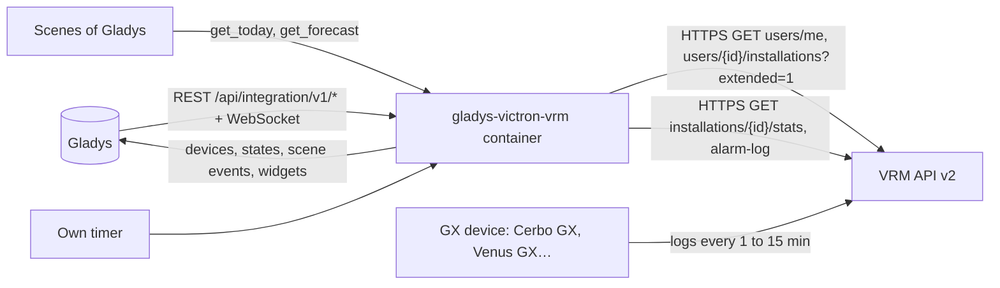
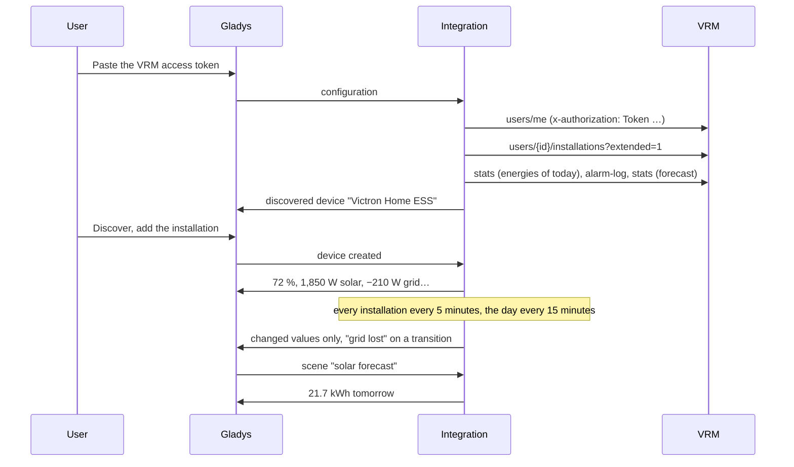
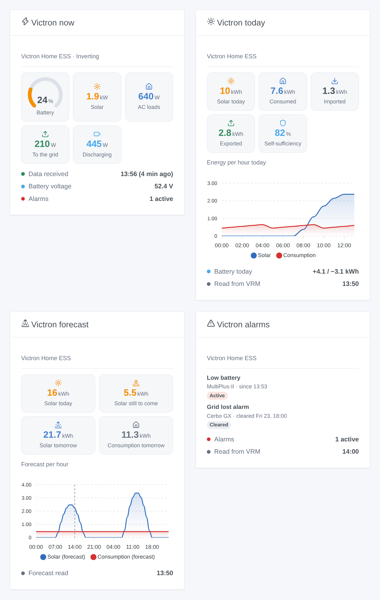

# Gladys Victron VRM

**English** · [Français](README.fr.md) · [Deutsch](README.de.md) · [Español](README.es.md)

[](LICENSE)
[](https://github.com/William-De71/gladys-victron-vrm/releases)
[](https://github.com/William-De71/gladys-victron-vrm/actions/workflows/release.yml)
[](https://gladysassistant.com)


[Gladys Assistant](https://gladysassistant.com) external integration for **Victron Energy** installations (home ESS, off-grid cabins, vans, boats) through the official [VRM API](https://vrm-api-docs.victronenergy.com/) and a personal access token. It shows the battery, the solar, the grid and the AC loads of each installation in Gladys, fires scenes on VRM alarms, a low or full battery, a grid loss or an installation that goes silent, and brings the VRM solar forecast to your scenes — read only.

User documentation: [English](docs/en.md) · [Français](docs/fr.md) · [Deutsch](docs/de.md) · [Español](docs/es.md).

Not affiliated with Victron Energy. **Not tested with a real VRM account yet**: the requests and the fields follow the official documentation and were checked live on the public VRM demo account; the answer to a wrong token was checked for real.

## Features

- Every **installation of the VRM account** of the token, found by itself, all read in **one request** (every 5 minutes by default).
- **One device per installation**: battery level, battery charge and discharge power, battery voltage, solar power and solar production of the day, signed grid power, AC loads and consumption of the day, generator power — only the parts the installation has.
- **9 scene triggers** (VRM alarm raised, alarm cleared, battery low, battery full, grid lost, grid restored, installation offline, back online, access refused), **2 scene actions** (energies of today, solar and consumption forecast) and **4 dashboard widgets** (energy flow now, today, forecast, alarms).
- **Read only**: only `GET` requests; no setting of the installation is ever changed.
- **Within the limits of VRM**: one request at a time, a pause for the time VRM asks after a 429 (Retry-After), the energies of the day every 15 minutes, the alarm log when VRM shows a change, the forecast every hour.
- Four languages everywhere: English, French, German, Spanish.

## How it works




From the token to a scene:



### Transport

`transports: ["cloud"]`: everything goes through the Victron cloud (`vrmapi.victronenergy.com`), which receives the data from the GX device of each installation. **The access token leaves your network** (to VRM only); the data of your installations come from VRM. `/data` keeps the list of the installations, the last readings, the energies and the forecast of the day, the alarm log and what the triggers know, and the VRM user id — never the token.

## Devices and features

| Device               | Features (category / type)                                                                                                                                                                                                                                                                                                                                                                                                                                                                                                                                          |
| -------------------- | ------------------------------------------------------------------------------------------------------------------------------------------------------------------------------------------------------------------------------------------------------------------------------------------------------------------------------------------------------------------------------------------------------------------------------------------------------------------------------------------------------------------------------------------------------------------- |
| One per installation | Battery level (`battery-storage` / `battery-level`, %), battery charge and discharge power (`battery-storage` / `charge-power`, `discharge-power`, W), battery voltage (`energy-sensor` / `voltage`, V), solar production (`energy-production-sensor` / `power`, W), solar production today (`energy-production-sensor` / `daily-production`, kWh), grid power (`grid-sensor` / `power`, W, import +), AC loads (`energy-sensor` / `power`, W), consumption today (`energy-sensor` / `index-today`, kWh), generator power (`energy-production-sensor` / `power`, W) |

- VRM gives the battery voltage and the signed battery current (positive when charging): the power is their product, split into charge power and discharge power, both positive, as the battery-storage category of Gladys wants.
- The grid power keeps its sign (`from_to_grid` of VRM: import > 0, export < 0), with symmetric bounds.
- The energies of the day come from the energy flows VRM counts per hour (solar to consumers, battery and grid; battery to consumers and grid; grid to consumers and battery; generator), in the timezone of the installation.
- **No double counting**: none of these features is an `energy-sensor` index nor a `daily-consumption`: Gladys never counts them as the consumption or the cost of the house. A Linky (or another meter) stays the source of the energy dashboard.
- The battery, solar, grid and generator features exist only when the installation has them (a value seen once, or what VRM says: `hasMains`, `hasGenerator`, `pvMax`); once there, they stay. External ids rest on the id of the installation in VRM (`ext:victron-vrm:site:<idSite>`).
- Values older than the offline delay of the configuration are not published again: Gladys keeps the last one with its time.

## Scene triggers, actions and widgets



**Widgets**: Victron now (battery gauge, solar, AC loads, grid to or from, battery charging or discharging, generator, the state of the system, the battery voltage, the active alarms, when VRM last received data), Victron today (solar, consumption, import, export, self-sufficiency, an hourly chart, the battery of the day), Victron forecast (solar today, still to come, tomorrow, consumption tomorrow, an hourly chart for today and tomorrow) and Victron alarms (the alarm log of VRM, active first).

**Triggers** (one event per transition, never at the first reading, never as the result of an action):

- **alarm raised** / **alarm cleared**: an entry of the VRM alarm log becomes active or is cleared (low battery, grid lost, overload, high temperature…); variables: the text, the Victron device, the start and end times, the duration;
- **battery low** at the level of the configuration (again 5 points above); **battery full** at 100 % (again under 95 %);
- **grid lost** / **grid restored**: the grid alarm of the system (`Agl`), with how long it lasted;
- **installation offline**: no new data in VRM for the delay of the configuration; **back online** when data comes again;
- **access refused**: VRM refuses the token — once per refusal.

Filter: the installation. The values (battery level, power) are device features: "battery above 80 %" is a device trigger of Gladys.

**Actions**:

- **energies of today**: solar, consumption, import, export, battery charged and discharged, generator, self-sufficiency, battery level and a sentence, from the last readings (no request).
- **solar forecast**: solar today, still to come today, tomorrow, consumption today and tomorrow (kWh) and a sentence; read from VRM when the forecast kept is older than an hour.

No action writes to the installation: the VRM API offers writes for some settings (Dynamic ESS, alarm rules), not a supported way to drive an inverter or a relay from a third-party token; this first version stays read only.

Examples:

- When **Victron VRM: grid lost** → send a notification "Power cut, battery at {{triggerEvent.data.battery_level}} %" and turn off the heaters on the inverter.
- Every evening at 21:00 → **Victron VRM: solar forecast**; if **solar tomorrow** is under 5 kWh → turn on the water heater during off-peak hours tonight.
- When **Victron VRM: installation offline** → send a notification "No data from the boat for {{triggerEvent.data.minutes_without_data}} min".

## Requirements

- Gladys Assistant **5.3.0** or later (widgets and scenes of integrations; catalog keywords and countries of Gladys 5.3): older instances cannot install the integration.
- A Victron installation with a GX device (Cerbo GX, Venus GX, Ekrano, a Raspberry Pi with Venus OS…) sending its data to [VRM](https://vrm.victronenergy.com), and a **VRM access token** (Preferences → Integrations → Access tokens).
- The internet: the integration talks to `vrmapi.victronenergy.com` only.

### The pace of the API

VRM documents a rolling window of 200 requests, one leaving every 0.33 s (about 3 requests per second), and answers 429 with a Retry-After past it. The integration is far below: one request at a time, one second apart at least; for one installation about 19 requests an hour (every installation of the account every 5 minutes in one request, the energies of the day every 15 minutes, the alarm log every 30 minutes or when VRM shows a change, the forecast every hour). After a 429 every request waits for the Retry-After (30 seconds to one hour).

## Installation

- **From the store**: Integrations → Victron VRM → Install.
- **From the repository URL**: Integrations → external integration → `https://github.com/William-De71/gladys-victron-vrm`.
- **Developer mode**: run `npm start` with the variables given by Gladys (see Development).

## Configuration

| Field or button                    | Default   | Meaning                                                                             |
| ---------------------------------- | --------- | ----------------------------------------------------------------------------------- |
| Access token                       | —         | Required, a secret: never shown again, never logged, never written to `/data`       |
| Reading of the installations       | 5 min     | 1, 2, 5, 10 or 15 min: one request for every installation of the account            |
| Level of the "battery low" trigger | 20 %      | 10 to 50 %                                                                          |
| Installation offline after         | 1 h       | 30 min, 1 h, 2 h or 4 h without new data in VRM                                     |
| Language of the texts              | automatic | Feature names, scene texts and errors                                               |
| Test the connection / Diagnostic   | —         | The installations of the token and their last data; the state in the logs, no token |

## Usage

1. On [VRM](https://vrm.victronenergy.com/access-tokens): Preferences → Integrations → Access tokens, create a token and copy it.
2. In Gladys (Integrations → Victron VRM → Configuration): paste the token; press **Test the connection**.
3. **Discover**, then add your installations as devices.
4. Add the widgets to a dashboard, build scenes with the features, the triggers and the actions.

## Development

```bash
npm install
npm test                       # node --test, a fake VRM on 127.0.0.1, never the network
npm run lint                   # ESLint
npm run format:check           # Prettier
npx github:GladysAssistant/integration-store . --skip-image-check
scripts/build-cover.sh         # cover.jpg from docs/assets/cover.svg
docs/illustrations/render.sh   # docs/assets/widgets.<lang>.png
```

Locally, the SDK reads `GLADYS_HOST_API_URL`, `GLADYS_INTEGRATION_TOKEN` and `GLADYS_INTEGRATION_SELECTOR` (given by Gladys in developer mode), and the integration reads `TZ`. `DEBUG=gladys-integration-sdk` shows the SDK logs.

The tests cover the HTTP client (the token header, 401 / 403 / 429 / 5xx, Retry-After, one request at a time), the parsers (answers recorded from the live API on the public demo account, null values), the forecast (local days, a 25-hour day), the triggers (hysteresis, transitions, the alarm log), the devices (the fields the Discovery screen requires, the core category contracts), the widgets (`validateWidgetContent`), the manifest, the four languages, the release script, and the whole integration against the fake Gladys of the SDK and a fake VRM HTTP server. `test/structure.test.js` freezes every key users store.

## Release process


Every merge on `main` runs the CI, then computes the version from the [Conventional Commits](https://www.conventionalcommits.org/) since the last tag: `feat` → minor, `fix` / `perf` → patch, `!` or `BREAKING CHANGE` → major (a minor below 1.0.0); `docs`, `chore`, `ci`, `test`, `style`, `refactor`, `build` alone publish nothing. The changelog section is generated, the tag pushed, the multi-architecture image built, then `main` receives the release commit, the GitHub Release is created and a last job checks the public image, the store validator and the topic.

- The pull request title becomes the squash commit, then the changelog line: write it in English, for the user (`pr-title.yml` checks it). Never edit `CHANGELOG.md` by hand.
- 1.0.0 is a decision: Actions → Release → Run workflow with `release-as: 1.0.0`. `dry-run` shows the version and the notes without publishing.
- **Protected branch**: the release pushes its commit to `main` with `GITHUB_TOKEN`. The `protect-main` ruleset (no deletion, no force-push) lets it through; a stricter rule (pull request required, status checks) would need GitHub Actions in its bypass list, or a GitHub App.
- After the first release, make the `ghcr.io` package public (Package settings → Change visibility), or Gladys cannot pull it.

## Troubleshooting

See [docs/en.md](docs/en.md#troubleshooting). Report issues with the versions of Gladys and of the integration, the GX device and its log interval, the message of **Test the connection** and the result of **Diagnostic** (in the logs of the integration). Never paste your access token.

## Contributing

Issues and pull requests are welcome. Run `npm run format:check && npm run lint && npm test` before opening a pull request, and keep every external id and stored key unchanged (see [CLAUDE.md](CLAUDE.md)).

## Security

See [SECURITY.md](SECURITY.md): report vulnerabilities privately. The access token is a `secret` field: never logged, never written to `/data`, sent to `vrmapi.victronenergy.com` only. A VRM token opens the whole account: the integration only uses it to read.

## Screenshots to come

The images above are illustrations, not screenshots. Real screenshots will go in `docs/assets/screenshots/` (PNG, 1280 × 800): `configuration.png`, `discovery.png`, `device.png` (an installation with its features), `scene-grid-lost.png` (a scene on the "grid lost" trigger), `dashboard.png` (the four widgets on a real installation).

## License

[Apache License 2.0](LICENSE) — see also [NOTICE](NOTICE). Victron Energy and VRM are trademarks of their owner. Thanks to the Gladys documentation and SDK, to Victron Energy for the public VRM API documentation and demo account, and to the authors of the Home Assistant "Victron Remote Monitoring" integration.
